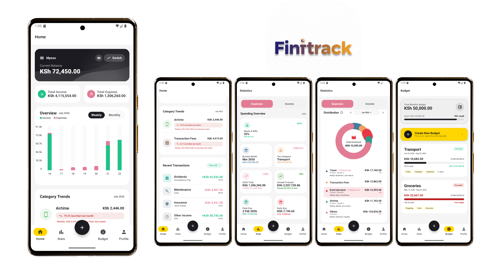

# 💰 Fintrack KMP — Offline-First, SMS-Powered Financial Intelligence

**Fintrack KMP** is a high-performance, **100% offline-first** personal finance app built with **Kotlin Multiplatform (KMP)** and **Jetpack Compose / Compose Multiplatform**. It automates expense tracking by parsing SMS notifications on-device and providing deep financial insights with zero network dependency.

Shared Kotlin business logic powers the engine on **Android** and **iOS**, with **SQLDelight** handling local SQLite database persistence, **WorkManager** automating offline background sync, and **Koin** providing multiplatform dependency injection.

---

## 📸 Screenshot

<div align="center">
  

*Professional dashboard featuring real-time balance tracking, automated insights, and smart budgets.*

</div>

---

## 🔥 Key Financial Features

### 📡 100% Offline SMS Detection & Parsing (Android)
* **Zero-Effort Tracking**: Real-time tracking of **M-Pesa** and **Equity Bank** SMS transactions without needing a remote backend server.
* **Intelligent Regex Engine**: Parses complex financial events including **Paybill Payments**, **Till Payments**, **Bank Transfers**, **Reversals**, **Loan Approvals**, **Agent Withdrawals**, and **Airtime Purchases**.
* **Raw SMS Preservation**: Stores full raw SMS bodies (`rawMessage`) in SQLite to support deep search queries, auditability, and retroactive rule matching.
* **Smart Multi-Word Token Matching**: Handles Safaricom SMS formatting quirks (such as double spaces between names like `"JOSEPH  MWAURA"`) with multi-word token matching.
* **Real-time Balance Reconciliation**: Automatically extracts balance information from SMS footers to reconcile local account balances.
* **Offline WorkManager Sync**: Uses `TransactionSyncWorker` configured with `Constraints.NONE` for guaranteed offline background database updates.
* **Real-Time Duplicate Filter**: Includes a 1-minute memory cache in `SmsReceiver` to prevent duplicate transactions when providers trigger multiple broadcast intents for a single payment.

### 🧠 Smart Category Rules & Retroactive Updates
* **Custom Keyword Mapping**: Create custom rules mapping merchant keywords or account numbers to specific expense/income categories.
* **Retroactive Rule Application**: Toggle *"Update existing matching transactions"* when creating a rule to re-assign all matching historical transactions in SQLite in a single transaction.

### 📊 Advanced Financial Analytics & Custom Analysis
* **Deep Custom Analysis**: Filter transactions by custom date ranges, account selections, transaction types (Expense/Income), amount ranges, and **full raw SMS text search**.
* **Essential Spend Ratio (50/30/20 Rule)**: Automatically calculates financial health by distinguishing "Essential" (Needs) vs. "Lifestyle" (Wants) spending.
* **Historical Look-Back & Highlights**: Evaluates monthly/weekly trends, top spending categories, and savings rates with context-aware insights.
* **Interactive Category Comparison**: Visual breakdowns of top spending categories on the Home and Statistics dashboards.

### 💾 Backup, Restore & Data Portability
* **Cloud & Local Backup**: Export and restore complete application backups via **Google Drive Cloud Storage** or as **encrypted local JSON files**.
* **Full Record Portability**: Backups preserve all accounts, categories, custom rules, budgets, and raw SMS messages.
* **Multi-Format Export**: Export transaction ledgers to **CSV, PDF, or JSON** for custom date ranges.

### 🛡️ Enterprise Security & Biometric Vault
* **Biometric Authentication**: Protect your financial data using **Fingerprint, FaceID, or TouchID**.
* **Configurable Auto-Lock Timeout**: Customize biometric auto-lock behavior under Settings (Immediately, 15s, 30s Default, 1m, 5m).
* **Hardware-Backed Protection**: Keys managed securely via Android Keystore and iOS Keychain.

---

## ✨ Polished UI & Performance Optimizations

* **120fps Smooth Scrolling**: Lightweight SQLite list queries (`CAST(NULL AS TEXT) AS rawMessage`) keep row sizes at ~50 bytes, eliminating Android 2MB `CursorWindow` memory overflows and main-thread GC pauses.
* **Zero Layout Shift Shimmers**: Skeleton loading states (`CustomAnalysisShimmerLoading`) match loaded card containers, shapes, and row counts 1:1, wrapped in a 350ms `Crossfade` transition.
* **Shared Element Transitions**: Smooth transitions across screens using the Compose Shared Transition API.
* **Dynamic Theming & Micro-interactions**: Real-time UI color shifts between Income (Green) and Expense (Pink) modes with bouncy button presses and skippable composables.

---

## 🚀 Tech Stack

**Multiplatform Core:**
- **Kotlin Multiplatform**: Shared business logic, repositories, and domain models.
- **Architecture**: Clean Architecture + MVVM + Repository Pattern.
- **Local Database**: **SQLDelight** (`FintrackDatabase.sq` with migration file `1.sqm`).
- **Dependency Injection**: Koin Multiplatform.
- **Serialization**: Kotlinx.Serialization (JSON & BigDecimal support).
- **Asynchronous**: Kotlin Coroutines + Flow (`debounce(300)`, `distinctUntilChanged`).
- **Pagination**: Paging 3 for smooth transaction list scrolling.

**Platform Integration:**
- **Android**: Jetpack Compose, WorkManager, AlarmManager, Material 3, Jetpack DataStore.
- **iOS**: Compose Multiplatform + SwiftUI, LocalAuthentication.

---

## 🛠️ Project Structure

```
fintrack-production/
├── shared/                       # Multiplatform shared module
│   ├── src/commonMain/           # Domain models, repositories, ViewModels, Compose UI
│   │   └── sqldelight/           # SQLDelight database schema & queries
│   ├── src/androidMain/          # Android SMS receiver, workers, parsers, DataStore
│   └── src/iosMain/              # iOS native drivers & authentication
└── androidApp/                   # Android application module
```

---

## ⚙️ Quick Start & Development Setup

1. **Environment**:
   - **Android**: Android Studio Koala+
   - **iOS**: Xcode 15+
2. **Build Android App**:
   ```bash
   ./gradlew :androidApp:assembleDebug
   ```
3. **Run Unit Tests**:
   ```bash
   ./gradlew :shared:testDebugUnitTest
   ```
4. **Data Seeding**:
   To test features with realistic historical data:
   * Go to **Profile** → **Settings** → **Seed Dummy Data**.
   * Populates 6 months of historical transactions to test charts, budgets, and analytics.

---

**Built with Love ❤️**
