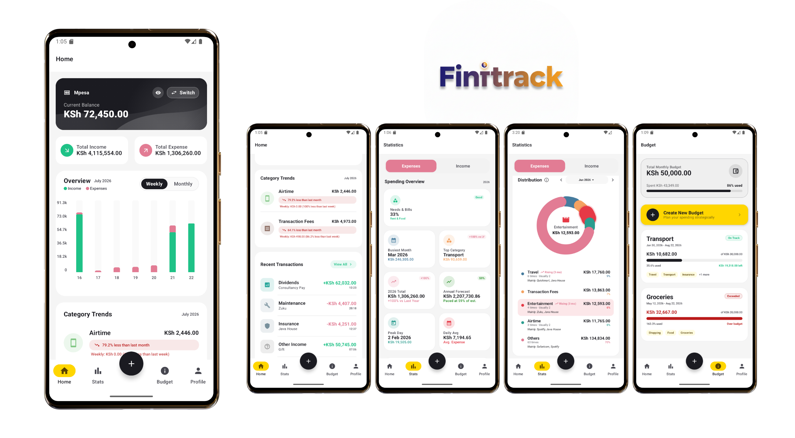

# 💰 Fintrack KMP — Offline-First, SMS-Powered Financial Intelligence

**Fintrack KMP** is a high-performance, **100% offline-first** personal finance app built with **Kotlin Multiplatform (KMP)** and **Jetpack Compose / Compose Multiplatform**. It automates expense tracking by parsing SMS notifications on-device, scanning receipt images via OCR, and delivering deep financial analytics—all with zero external network dependency or privacy compromise.

Shared Kotlin business logic powers the engine on **Android** and **iOS**, with **SQLDelight** handling local SQLite database persistence, **WorkManager** automating background sync, and **Koin** providing multiplatform dependency injection.

---

## 📸 Screenshot

<div align="center">
  

*Professional dashboard featuring real-time balance tracking, automated insights, and smart budgets.*

</div>

---

## 🔥 Key Financial Engines & Features

### 🧠 Financial Health Index & 50/30/20 Budget Optimizer
* **4-Pillar Financial Health Index**: Scores overall financial well-being (0–100) across four core pillars: Savings Rate, Emergency Shield, Debt-to-Income Ratio, and Budget Rule Alignment.
* **50/30/20 Budget Optimizer**: Categorizes allocations into **Needs (50%)**, **Wants (30%)**, and **Savings (20%)** with multi-period lookbacks (**30d, 60d, 90d, 6mo, 1yr**).
* **Actionable Trim Recommendations**: Identifies specific overbudget discretionary categories and suggests exact monthly cost-trimming amounts to restore financial balance.

### 🔮 Cashflow Runway, EOM Forecast & Affordability Simulator
* **End-of-Month (EOM) Projection**: Forecasts expected month-end account balances by factoring 30-day daily burn rates, variable spend patterns, and upcoming scheduled bill commitments.
* **Overdraft & Depletion Warning**: Calculates cash depletion timelines and alerts you before potential balance overdrafts occur.
* **Purchase Affordability Simulator**: Interactive tool to model the impact of major prospective purchases on your cash runway and savings goals before spending.

### 🛡️ Emergency Shield & Passive Income Coverage
* **Emergency Reserve Score**: Evaluates your liquid cash reserves against monthly living expenses to calculate your financial safety net runway.
* **Passive Income Coverage**: Tracks the ratio of non-active income against fixed recurring expenses to measure financial independence progress.

### 🎯 Planning Hub & Savings Goals Vault (Sinking Funds)
* **Unified Planning Hub**: Integrates **Category Spending Budgets** and **Savings Goals Vault** (Sinking Funds) in a single segmented interface.
* **Auto-Calculated Contributions**: Computes exact required periodic contributions ($\frac{\text{Target} - \text{Saved}}{\text{Time Remaining}}$) based on target completion dates.
* **Cashflow Feasibility Badges**: Dynamically evaluates goal targets against actual 30-day net surplus ($\text{Income} - \text{Expenses}$), marking goals as **`🟢 On Track with Surplus`** or **`🟡 Surplus Gap`**.
* **Automatic Category Auto-Sync**: Automatically credits or debits goal progress whenever categorized transactions or parsed SMS receipts match linked categories.

### 📡 100% Offline SMS Parsing & OCR Receipt Scanner (Android)
* **Zero-Effort Automated Tracking**: Real-time parsing of **M-Pesa** and **Equity Bank** SMS alerts without sending data to external servers.
* **Intelligent Regex & AI Engine**: Parses Paybill, Till, Bank Transfer, Reversals, Loans, Agent Cashouts, and Airtime messages. Includes optional **Gemini AI SMS parser** integration for complex message structures.
* **Camera OCR Receipt Scanner**: On-device image text scanner extracts merchant name, date, and amount directly into transaction forms.
* **Deduplication & Raw Message Vault**: Features a 1-minute memory cache to suppress duplicate broadcast intents while storing complete raw SMS text in SQLite for deep search and retroactive rule matching.
* **Background Sync**: Uses `TransactionSyncWorker` for guaranteed offline background database updates.

### 🧠 Custom Category Rules & Retroactive Updates
* **Keyword & Merchant Rules**: Map custom merchant keywords or account numbers to designated expense/income categories.
* **Retroactive Rule Execution**: Re-assign historical transactions matching newly created rules across the SQLite database in a single atomic operation.

### 📊 Merchant Analytics & Deep Custom Search
* **Merchant Analytics**: Tracks top merchants, visit frequency, total volume, and average ticket sizes across customizable timeframes.
* **Multi-Criteria Analysis**: Filter ledgers by custom date ranges, account selections, transaction types, amount bounds, and full-text raw SMS queries.
* **Category Visualizations**: Interactive donut breakdown charts and category totals for instant spend distribution analysis.

### 💾 Backup, Restore & Ledger Export
* **Cloud & Encrypted Local Backups**: Securely export and restore complete app state via **Google Drive Cloud Storage** or encrypted local JSON files.
* **Multi-Format Ledger Export**: Export filtered transaction logs to **CSV, PDF, or JSON** files.

### 🛡️ Enterprise Security & Biometric Vault
* **Biometric Auth**: Protect your financial data using **Fingerprint, FaceID, or TouchID**.
* **Configurable Auto-Lock**: Set auto-lock timeouts (Immediately, 15s, 30s Default, 1m, 5m).
* **Hardware Security**: Managed via Android Keystore and iOS Keychain.

---

## ✨ Polish & Performance Optimizations

* **120fps Smooth Scrolling**: Lightweight SQLite list projections (`CAST(NULL AS TEXT) AS rawMessage`) keep row payload sizes under ~50 bytes, avoiding CursorWindow memory bottlenecks.
* **Zero Layout Shift Shimmers**: Pixel-aligned skeleton loaders match exact card geometries and row counts during asynchronous state hydration.
* **Micro-Interactions**: Dynamic color shifts between Income (Green) and Expense (Pink) contexts with tactile haptic feedback.

---

## 🚀 Tech Stack

**Multiplatform Core:**
- **Language**: Kotlin Multiplatform (KMP).
- **Architecture**: Clean Architecture + MVVM + Repository Pattern.
- **Database**: **SQLDelight** (`FintrackDatabase.sq`).
- **Dependency Injection**: Koin Multiplatform.
- **Async & Reactive**: Coroutines + Flow (`debounce`, `distinctUntilChanged`).
- **Pagination**: Paging 3.

**Platform Native:**
- **Android**: Jetpack Compose, WorkManager, Material 3, Jetpack DataStore, Camera/OCR.
- **iOS**: Compose Multiplatform + SwiftUI, LocalAuthentication.

---

## ⚙️ Quick Start & Development Setup

1. **Prerequisites**:
   - **Android**: Android Studio Koala+ & JDK 17+
   - **iOS**: Xcode 15+
2. **Build Android App**:
   ```bash
   ./gradlew :androidApp:assembleDebug
   ```
3. **Run Unit Tests**:
   ```bash
   ./gradlew :shared:testDebugUnitTest
   ```
4. **Data Seeding**:
   Populate realistic historical test data:
   * Navigate to **Profile** → **Settings** → **Seed Dummy Data**.
   * Injects 6 months of historical transactions to test charts, budgets, and analytics engines.

---

**Built with Love ❤️**
